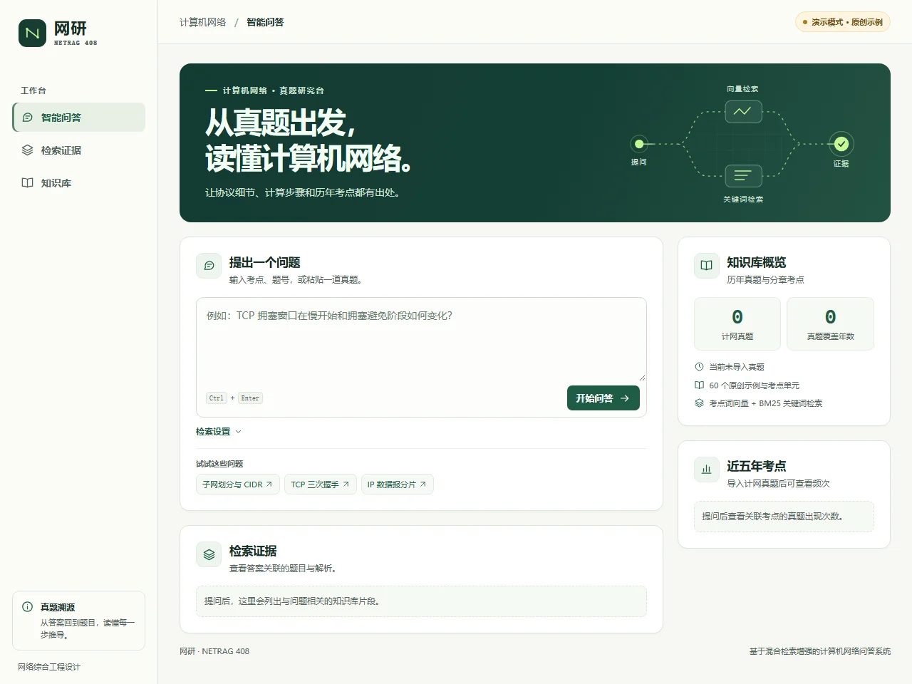

# NetRAG 408 · 计算机网络问答实验室

面向考研 408 的计算机网络问答系统。可以按年份和题号查真题，用自然语言查考点，也可以输入 IPv4 子网或 TCP 窗口的数值题，查看公式、计算过程和证据来源。

- **公开演示**：内置 60 张原创考点卡，覆盖计算机网络六章。无需模型或 API 密钥即可运行。
- **本地真题**：从数据层交付包导入 2009–2026 年的 162 道计网真题，与考点卡组成 222 条可检索记录。近五年频次只统计真题，原创资料在界面中单独标明。
- **检索与生成**：查询改写、BM25 与余弦向量检索、RRF 融合、Top-3 证据和可选 BGE 重排。生成支持本地资料回答、确定性计算和 OpenAI 兼容接口。



## 快速运行

需要 Python 3.11 或更高版本。在仓库根目录运行：

```powershell
python -m venv .venv
.\.venv\Scripts\python.exe -m pip install -r requirements.txt
.\.venv\Scripts\python.exe -m netrag
```

macOS / Linux：

```sh
python3 -m venv .venv
.venv/bin/python -m pip install -r requirements.txt
.venv/bin/python -m netrag
```

打开 [问答页面](http://127.0.0.1:8000/) 或 [API 调试页面](http://127.0.0.1:8000/docs)。可以试问：

- `TCP 三次握手为什么需要第三次确认？`
- `192.168.10.77/26 的网络地址、广播地址、可用主机数分别是多少？`
- `TCP 接收窗口 8 KB，拥塞窗口 6 KB，在途 2 KB，还能发送多少？`

## 导入真题

使用你本地的原始数据层 RAR，或者使用其解压目录、`data/structured/questions.jsonl`。RAR 读取需要 Windows 自带的 `tar` 或支持 RAR 的 `bsdtar`；如果本机工具不支持，使用已解压的目录即可。

```powershell
.\.venv\Scripts\python.exe -m netrag.import_data "C:\path\to\data-layer.rar" --output local_data
.\.venv\Scripts\python.exe -m netrag --data-dir local_data
```

输入 `2026_37` 或 `2024 年第 38 题` 可直接查看单题。也可在网页选择真题年份后按考点检索。导入器只取网络科目结构化记录，重新构建索引和频次，不执行压缩包中的代码，也不读取其中的 pickle。原始资料、私有题库、数据报告、密钥和本地评测输出由 `.gitignore` 排除。公开演示仅使用原创考点，未从第三方来源转发真题全文。

交付包的 656 条记录包含其他科目；其中 162 条是计算机网络真题，跨 18 年。组合语料超过 200 条，但真题数量仍是 162 道。源数据缺少的解析、题图信息或勘误将在对应记录中保留或提示。

## 启用模型和双索引

默认使用轻量的 CJK BM25、TF-IDF/考点特征余弦检索和 RRF。可以安装可选依赖，使用 [BGE 中文向量模型](https://huggingface.co/BAAI/bge-small-zh-v1.5) 与 [BGE 重排模型](https://huggingface.co/BAAI/bge-reranker-base)：

```powershell
.\.venv\Scripts\python.exe -m pip install -r requirements-models.txt
$env:NETRAG_EMBEDDING_MODEL = "BAAI/bge-small-zh-v1.5"
$env:NETRAG_RERANKER_MODEL = "BAAI/bge-reranker-base"
$env:NETRAG_USE_JIEBA = "1"
$env:NETRAG_USE_FAISS = "1"
.\.venv\Scripts\python.exe -m netrag --data-dir local_data
```

首次启动会下载模型并构建归一化 FAISS 内积索引；环境变量也接受本地模型目录。`NETRAG_CANDIDATE_K` 可调整候选数，默认 20；`NETRAG_BM25_WEIGHT` 和 `NETRAG_DENSE_WEIGHT` 可调整 RRF 权重，默认均为 1。启用模型时可在 `/api/health` 核实当前索引、分词和重排后端。

若需生成式回答，设置 `NETRAG_LLM_BASE_URL`（例如 `http://127.0.0.1:11434/v1`）、`NETRAG_LLM_MODEL` 和服务要求的 `NETRAG_LLM_API_KEY`。系统向该地址的 `/chat/completions` 发送问题及检索证据。使用本地真题库时，应选择有权接收这些内容的服务。模型未配置、响应失败或返回无效引用时，应用使用本地证据回答；能直接求解的数值题由确定性计算器完成。

## 验证与部署

```sh
python -m pip install -r requirements-dev.txt
python -m pytest -q
python -m netrag.evaluate eval/demo.jsonl --output eval_local/demo-result.json
```

评测支持 BM25、向量及混合检索对照，统计 P@3、上下文精确率、命中率和延迟；可导入逐条人工评审计算答案准确率和幻觉率。见[设计与验收说明](docs/design.md)和[实测结果](docs/evaluation.md)。

也可运行 `docker build -t netrag-408 .` 后用 `docker run --rm -p 127.0.0.1:8000:8000 netrag-408` 启动公开演示。容器的真题模式需要另行以只读卷挂载本地数据，并设置 `NETRAG_DATA_DIR`。
