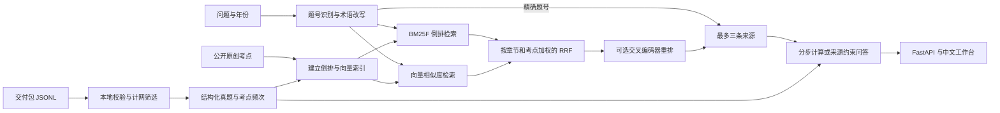

# 系统设计与验收

NetRAG 408 面向计算机网络考点和 408 真题。问答结果包含解析、可展开的来源和关联考点频次。浏览器通过同一组 API 使用演示库或本地真题库。



- **数据层**从用户提供的结构化交付包读取计网题，按稳定 ID 校验并保留题型、选项、章节、考点与质量标记。最近五年以导入库的最新年份为上界，按同一考点命中的题数统计。原创考点单独标记，真题频次只统计真题。
- **检索层**识别直接输入的年份题号。对一般查询归一化用词，扩展常用术语，再通过分字段 BM25F 和向量检索召回候选。混合模式按 `Σ w/(60 + rank)` 融合，排名从 1 开始，再按章节匹配和考点覆盖加权。启用交叉编码器后，用原问题重排短名单并保留融合分作为排序信号。返回最多三条候选，附分值和召回通道。
- **生成层**对满足规则的 IPv4 子网与 TCP 窗口问题直接给出可核算的步骤。配置生成服务后，服务端核对结构化引用和正文引用是否来自实际返回的证据。模型确认资料不足时，提示补充条件。模型调用失败或引用无效时，应用根据已有资料提供摘录或提示资料不足。

## 运行模式与接口

公开演示库内置原创考点，可以离线完成检索和基础问答。本地真题模式使用 `NETRAG_DATA_DIR` 指向导入结果，将真题与原创考点一起索引。默认使用考点词向量和 BM25，也可配置 BGE、FAISS、jieba 和交叉编码器。检索配置与是否启用大模型生成彼此独立。

| 接口 | 行为 |
| --- | --- |
| `GET /api/health` | 查看语料模式、数量、覆盖年份和当前后端 |
| `POST /api/search` | 获取改写信息、最多三条证据、相关考点频次与检索耗时 |
| `POST /api/ask` | 在检索结果上增加答案和生成方式，耗时包含检索与生成 |
| `GET /api/sources/{id}` | 按来源 ID 返回题目或考点，未知 ID 返回 404 |
| `GET /api/frequency` | 查看真题库中可统计的考点频次 |

`/api/search` 和 `/api/ask` 接收 JSON，例如 `{"query":"TCP 三次握手","year":null,"strategy":"hybrid"}`。`year` 可填年份，`strategy` 支持 `hybrid`、`dense` 和 `bm25`。问答方式包括 `calculation`（规则推导）、`llm`（模型解析）、`extractive`（资料解析）和 `insufficient`（资料不足）。

## 复现与验收

```text
python -m pytest -q
python -m netrag.evaluate eval/demo.jsonl
```

自动测试覆盖资料导入、计网范围筛选、题号匹配、混合排序、计算规则、引用核对和 API。Chrome 桌面与手机尺寸已在演示模式和本地真题模式通过问答检查。演示评测使用原创查询，适合比较三种检索策略和检查计算输出。

| 目标 | 验收方式与当前状态 |
| --- | --- |
| 至少覆盖 5 年、200 道计网真题 | 本地交付资料实测覆盖 2009—2026 年，包含 162 道计网真题。覆盖年数已满足，真题数量仍差 38 道。原创考点和其他科目题不计入真题数量。 |
| Precision@3 ≥ 92%，上下文精确率 ≥ 90% | 对固定标注的真题与考点查询使用每题三个固定分母。基线、复测和样本局限见 [检索评测](evaluation.md)。 |
| 答案准确率 ≥ 88%，幻觉率 ≤ 5% | 用实际模型调用的回答逐条对照标准要点及检索证据。回答摘要绑定审查记录。运行参数、审查来源和分组结果见 [生成评测](generation-evaluation.md)。 |
| 单条解析 ≤ 5 秒 | 记录模型和硬件配置下的实测 P95、最大耗时和 5 秒内完成比例。见 [生成评测](generation-evaluation.md)。 |

真题评测 JSONL 每行应含 `id`、`query` 与 `relevant_ids`，可选 `year` 和 `answer_contains`。用 `--data-dir` 指向本地库，用 `--output` 保存逐条输出。人工判定 JSONL 使用 `id`、`answer_sha256`、`correct`、`hallucinated` 四个字段，复核时固定语料、策略和模型配置。
